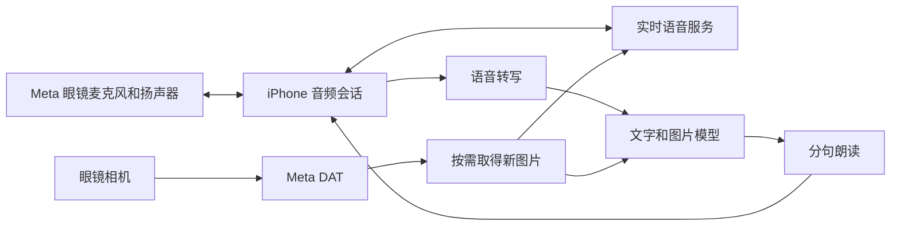

# LensMate iOS 方案与使用指南

更新日期：2026-10-23。

> 当前优先级已调整为中、英、泰实时翻译，第一版统一接阿里云。请先看[阿里云实时翻译方案](aliyun-translation-plan.md)和[交互式工作原理图](translation-flow.html)。下文保留通用语音助手、视觉和 DIY 研究；多模型试验顺序不再作为当前翻译 MVP 的执行顺序。

推荐基于 OpenVision 做一个精简的 iPhone 配套 App，优先改善从说完问题到听见回答的时间。先试 Gemini Live 和 OpenAI Realtime，再根据实际使用地区加入 DeepSeek。眼镜负责采集和播放，iPhone 负责连接与调用模型。

本仓库目前只有文档，尚无可安装的 LensMate App。下文区分可试用的上游项目与计划开发的功能；本次没有执行编译、账号授权、付费模型调用或眼镜真机测试。

## 设备前提与资料更新

已确认手机是 iOS。原技术指南记录的眼镜是 Blayzer Optics Gen 2，本方案暂沿用该型号；iPhone 型号、iOS 版本、眼镜固件和常用网络仍待填写。按无镜内显示屏设备设计，文字内容显示在手机上。

这次核对有三个直接影响实施的发现：

- **DAT 的发布状态需要更新。** Meta 官网 FAQ 说 DAT 1.0 已成为稳定版本，自 2026-09-30 开始推出；官方 GitHub README 仍保留 Developer Preview 表述。公开提交和发现入口的开放时间另行公布，不能由 SDK 稳定推导出任意应用已经能公开发布。[Meta FAQ](https://developers.meta.com/wearables/faq/)
- **语音唤起等能力仍需分别判断。** iOS CHANGELOG 将 Voice invocations、Speech、Inputs 和相机音频流标为 Experimental。先从手机启动会话，后续再验证语音启动；不要把第三方应用启动理解成可以任意替换系统唤醒词。[DAT CHANGELOG](https://github.com/facebook/meta-wearables-dat-ios/blob/main/CHANGELOG.md)
- **版本必须成套。** OpenVision v2.14.0 的工程要求 iOS 18，锁定 DAT 0.9.0；v2.13.0 已包含 Blayzer 连接修复。先验证这个可复现起点，再单独评估升级 DAT 1.0.1。[工程配置](https://github.com/rayl15/OpenVision/blob/v2.14.0/project.yml)、[Blayzer 修复说明](https://github.com/rayl15/OpenVision/releases/tag/v2.13.0)

## 为什么优先实时语音

你感受到的延迟包括：识别说话结束、语音转写、网络往返、模型推理、语音合成和播放器缓冲。现在没有测量，尚不能确定 Meta AI 慢在哪一段。

LensMate 建议保留两条独立链路：



实时路径直接收发语音，减少应用侧串行处理，适合作为低延迟候选；另一条路径方便接入 DeepSeek、本地模型和不同语音引擎。谁更快由同一网络、同一副眼镜的测试决定。

| 场景 | 首选测试方案 | 接入方式与取舍 |
|---|---|---|
| 服务支持地区的自然聊天 | Gemini Live | OpenVision 已有实现；连续音频、视觉与打断能力适合快速验证 |
| 实时语音的第二个对照 | OpenAI Realtime | 使用正式 API；须进入实时模式，普通文字聊天加朗读不是同一条链路 |
| 中国大陆的文字与看图问答 | DeepSeek Flash 加转写和朗读 | 关闭思考模式，流式分句播放；延迟要连同转写、朗读一起测 |
| 后续离线或私有部署 | iPhone 端模型或 Mac 服务 | 根据手机内存和实际速度选择；Mac 模式依赖机器在线和网络 |

Gemini 的官方接口支持双向实时音频、图片和用户打断；OpenAI Realtime 支持语音会话及图片输入。模型名按所选服务当前可用列表与上游实现共同核对，不因为更换名字就假设新协议兼容。[Gemini Live](https://ai.google.dev/gemini-api/docs/live-api)、[OpenAI Realtime](https://developers.openai.com/api/docs/guides/realtime-conversations)

DeepSeek 官方当前给 `deepseek-flash` 提供图片输入，并默认启用高强度思考。日常快问快答应明确发送 `thinking: {"type":"disabled"}`，不能只改 Base URL 后就认为延迟优化完成。[图片接口](https://api-docs.deepseek.com/guides/vision/)、[思考模式](https://api-docs.deepseek.com/guides/thinking_mode/)

如果主要在中国大陆使用，先测当地可用的 DeepSeek 链路。Google API 的可用地区和 Meta 开发接入地区都需要单独确认；换掉模型后端不会同时改变眼镜配对和注册依赖。[Google 地区清单](https://ai.google.dev/gemini-api/docs/available-regions)、[Meta 地区说明](https://developers.meta.com/wearables/faq/)

## 第一版产品设计

首页保留设备状态、当前模型和三个主要操作：

| 操作 | 预期行为 |
|---|---|
| 开始聊天 | 连接选定服务，明确显示正在听；首版默认纯语音 |
| 看一眼 | 取得当前画面，带着本轮问题发给支持图片的模型 |
| 停止 | 同时停止录音、相机、播放和本轮请求，丢弃过期回调 |

模型选项显示用户能理解的名称，例如“Gemini 实时”“OpenAI 实时”“DeepSeek”。设置页再放 API Key、模型 ID、语音、历史和数据删除。调试页显示真实音频输入输出设备、图片时间、连接状态和延迟，避免“蓝牙已连上”掩盖“正在使用手机麦克风”。

首轮回答默认一至两句，用户再追问细节。普通聊天不启动相机，不默认联网搜索或调用工具；这样能减少不必要的等待和耗电。看图功能先采用主动拍一张，持续视觉作为独立模式。

开发上复用 OpenVision 的设备管理、音频、模型客户端和会话 UI。新增 `RealtimeConversationProvider` 与 `TextVisionProvider` 两类适配，不强迫实时音频走“转写、文本模型、朗读”接口。共享连接、取消和历史管理，分别处理各自的流式事件。

个人自用版允许用户在手机设置中输入自己的 API Key，存入 Keychain，禁止放进源码或日志。若以后分发由我们付费的服务，长期服务密钥放后端，由受保护的接口签发短期凭据，音频尽量直接连接模型服务。[OpenAI WebRTC 凭据流程](https://developers.openai.com/api/docs/guides/voice-webrtc)、[Gemini 客户端连接](https://ai.google.dev/gemini-api/docs/live-api)

## 现在可以怎样试

先判断是否只是想立即比较另一家 AI 的语音：可以在 iPhone 上打开现有语音助手 App，尝试把 Meta 眼镜作为蓝牙音频设备。要分别检查声音输出和麦克风来源；这只能检验音频体验，不能自动把眼镜摄像头提供给那个 App。

要验证自有 App 的相机和实时模型，按下面的 OpenVision 路线进行。安装步骤依据固定标签的配置与发布说明，尚未在你的设备上执行。

### 准备条件

1. 用 Meta AI App 完成正常配对，确认原生拍照和音频可用。
2. 确认 iOS 至少为 18；Mac 安装能支持该手机系统的 Xcode，完成首次启动组件安装。
3. 准备 Apple 开发签名与 Meta Wearables Developer Center 项目。先试免费 Personal Team；部分能力是否可签名由实际工程决定，免费描述文件通常需要每 7 天重新安装。[Apple 账号说明](https://developer.apple.com/help/account/basics/about-your-developer-account)
4. 准备一个正式模型 API Key。Gemini 从 Google AI Studio 创建；OpenAI 实时模式使用 API Key。费用按实际供应商账号和用量计算。

OpenVision 当前 SETUP 要求从源码构建；不要把其他项目的 TestFlight 链接当成它的下载入口。该 SETUP 中的旧 iOS 和 DAT 数字也不能覆盖 `project.yml` 的实际配置。[安装文档](https://github.com/rayl15/OpenVision/blob/v2.14.0/SETUP.md)

### 在 Mac 建立实验副本

以下使用独立目录，保留 LensMate 现有文档仓库。已有 Homebrew 时安装 XcodeGen，然后执行：

```bash
brew install xcodegen
cd /Users/bobby/Bobby/Code/Software
git clone --branch v2.14.0 --single-branch https://github.com/rayl15/OpenVision.git LensMate-OpenVision
cd LensMate-OpenVision
git switch -c lensmate/baseline
cp Config.xcconfig.example Config.xcconfig
cp OpenVision/Config/Config.swift.example OpenVision/Config/Config.swift
```

编辑 `Config.xcconfig`，填好自己的 `DEVELOPMENT_TEAM`、唯一的 `PRODUCT_BUNDLE_IDENTIFIER`、`META_APP_ID`、完整格式的 `CLIENT_TOKEN` 和回调 `APP_LINK_URL_SCHEME`。Meta Client Token 的模板格式是 `AR|应用ID|客户端Token`，它不是模型 API Key。[配置模板](https://github.com/rayl15/OpenVision/blob/v2.14.0/Config.xcconfig.example)

随后执行：

```bash
xcodegen generate
open OpenVision.xcodeproj
```

在 Xcode 选择签名 Team 和已连接的 iPhone，用 Run 安装；按系统提示开启 iPhone 开发者模式。遇到 Metal 编译器缺失时，再按上游要求安装 Metal Toolchain。先原样编译，不同时升级所有依赖。[构建说明](https://github.com/rayl15/OpenVision/blob/v2.14.0/SETUP.md)

### 连接这副眼镜

1. Meta AI App 中进入设置的 About 或版本信息页，按当前界面开启 Developer Mode；上游说明的入口是连续点击版本号五次。
2. Meta 开发后台核对应用身份、Apple Team ID 和相机访问用途。
3. OpenVision 发起注册，完成跳转 Meta AI 的授权和回调。
4. 在眼镜设置中执行 `Install/Update Glasses App`，完成 Meta AI 引导的眼镜端组件安装。
5. 验证设备可发现、新照片可取得，以及录音和播放实际经过眼镜。

具体操作可对照 [OpenVision SETUP](https://github.com/rayl15/OpenVision/blob/v2.14.0/SETUP.md) 与 [v2.13.0 迁移说明](https://github.com/rayl15/OpenVision/releases/tag/v2.13.0)。如果旧版本被当前固件拒绝，记录错误，再做 SDK 升级；不要用反复重试掩盖版本不兼容。

### 配置并试用模型

**Gemini 路线：** 在 Settings → AI Backend 选择 Gemini Live，在 Gemini Settings 填入 Key。进入会话页面启动语音；先问普通问题，再试相机。上游提供 `Ok Vision, start video stream` 和 `Stop video` 命令作为视觉模式入口；它们属于运行中的 App 交互，不是替换 `Hey Meta`，也不代表后台唤起已可靠。[上游用法](https://github.com/rayl15/OpenVision/tree/v2.14.0)

**OpenAI 对照：** 选择 OpenAI 后填正式 API Key，并使用 Realtime 对应的 live 模式进行比较。只在普通聊天框选一个文字模型，会走另一条语音链路。使用相同问题、网络和回答长度，分别记录延迟。

上游 live 模式可能同时启动相机。基线测试要记录相机是否开启，纯语音与带图结果分组；计划中的“纯语音默认关闭相机”需在 LensMate 阶段单独实现和验收。

**DeepSeek 路线：** 文字后端使用 `https://api.deepseek.com`、`deepseek-flash` 和自己的 Key；先关闭工具做最小文字请求，再加图片。开发时补齐关闭思考和分句朗读的适配。这里的 OpenAI 兼容设置只适用于文字与图片接口，不能把这个地址拿去当 OpenAI Realtime 服务。

ChatGPT 的订阅授权单独放到后续。官方已提供符合条件的计划使用路径，但该路径不支持音频和视频输入；OpenVision 内置的 Codex 后端登录也不能等同于它。订阅登录不是这次实时语音 MVP 的前提。[官方计划使用限制](https://developers.openai.com/siwc/token-sharing-open-source/preview-limitations)、[OpenVision 登录说明](https://github.com/rayl15/OpenVision/tree/v2.14.0)

## LensMate 做成后的日常用法

这部分是待开发的目标交互：戴上眼镜，打开 LensMate，选模型，点“开始聊天”；普通问题直接说，需要看图时点“看一眼”，完成后点“停止”。第一轮保持 App 在前台。

第二轮加入快捷指令或操作按钮入口，减少找 App 的步骤。启动入口不等于允许应用无限后台运行；能否锁屏聊天、锁屏取图、重新唤起，要分别测试。

OpenVision 的 Blayzer 修复说明明确指出 raw 视频流会在锁屏时暂停。因此“放进口袋继续看图”不属于首版已经成立的使用方式，后续要按编码格式、SDK 和 iOS 生命周期验证。[锁屏相关说明](https://github.com/rayl15/OpenVision/releases/tag/v2.13.0)

## 网上值得借鉴的 DIY 项目

以下是项目公开描述的能力，不代表在你的 Blayzer 上验证过。优先借鉴有用的功能；复用代码前另查许可证与设备兼容性。

| 项目 | 平台与玩法 | 对 LensMate 的价值 |
|---|---|---|
| [OpenVision](https://github.com/rayl15/OpenVision) | iOS；多模型、视觉问答、笔记、提醒及本机推理 | 作为实施起点；先保留少数常用入口 |
| [Max AI Assistant](https://github.com/maxaistudios/max-ai-assistant) | iOS；将已拍画面做成可搜索视觉记忆，例如查曾记录的物品位置 | 第二阶段做“记住这个”；答案必须指向实际保存的照片和时间 |
| [Dashhound Rewind](https://github.com/jsala1/dashhound) | iOS 实验项目；循环保留约 45 秒，双击保存过去片段 | 可用于旅行或活动精彩片段；持续取流的耗电及音频冲突需要单独测试 |
| [Intent-Lab VisionClaw](https://github.com/Intent-Lab/VisionClaw) | iOS 和 Android；实时视觉、工具执行、第一视角分享 | 第三阶段研究远程协作；当前主线涉及自建网关、LiveKit 和 worker，部署成本较高 |
| [Meta Cookbook 03_visionclaw](https://github.com/meta-models/meta-model-cookbook/tree/main/03_use_cases/03_visionclaw) | iOS；拍一张、问一句、服务端回答 | 适合作为精简视觉问答架构参考，与上一项目不同 |
| [Hey Casa](https://github.com/locafra/hey-casa) | Android；眼镜语音调用 Home Assistant | 借鉴开灯、查设备状态的交互；不能直接安装到 iPhone |
| [Visor](https://github.com/macedonga/visor) | Android；通过眼镜协议实现自选模型和原生口令交互 | 说明网上确有更深入的改造；目前不作为 iOS 主路线 |

Max 的 README 提供 [TestFlight 入口](https://testflight.apple.com/join/781dSq1G)，要求 iOS 26.2。可以作为现成体验候选，但本次未确认名额或你的眼镜授权能否成功；无需为体验它先改写 LensMate。

另查到 Sightline 的 iPhone 方案，不过其[作者页面](https://techstandpoint.com/sightline/iphone/)在本次访问时仍写着意向名单，并说明功能未与 Android 对齐。网上同时出现了公开测试邀请的帖子，入口状态不一致，暂不把它列为能立即安装的主方案。

适合你优先做的玩法是菜单和路牌翻译、随口记笔记，以及主动保存一张画面后搜索。视觉记忆不会自动知道没有拍过的物品位置；普通 Blayzer 的译文通过耳朵听或在手机看，不设计镜内字幕。

## 实施顺序和验收

| 阶段 | 工作 | 完成标准 |
|---|---|---|
| A | 原版 OpenVision 构建和设备验证 | 真机得到一张新照片，确认眼镜输入输出，记录准确版本 |
| B | Gemini Live 与 OpenAI Realtime 对比 | 测出说完到首个有效语音的延迟，以及中断、错误和费用 |
| C | LensMate 精简界面与纯语音模式 | 三个主要操作可用；相机可独立关闭，停止后无旧回答继续播放 |
| D | DeepSeek 和按需视觉 | 中文转写、非思考请求、流式分句播放、图片新鲜度分别通过 |
| E | 便捷启动与后台能力 | 锁屏音频、锁屏视觉、来电恢复和重连分别记录结果 |
| F | 笔记、视觉记忆、本地服务 | 每项功能有明确使用场景，再决定是否加入 |

延迟验收使用 20 个固定中文短问题，在同一网络下分别测试 Meta AI 与候选方案；冷启动和已连接会话分开统计。记录说话结束、模型收到请求、首段回答到达、首段实际播放四个时间。提示音或“让我看看”不计为有效回答。

建议把普通暖会话的首个有效回答 P50 不超过 2 秒作为优化目标，同时争取比 Meta AI 基线减少至少 30%；这些是验收目标，不是已测性能。另报 P95、成功率、答非所问率、打断耗时及连续 15 分钟后的发热、电量和费用。如果目标未达到，按分段耗时调整，而不是继续堆模型。

最先要完成的是 A 和 B。确认另一条链路在你的设备与网络下确实改善体验后，再以它为 LensMate 默认模式；中国大陆场景可将 D 提前为首个模型实验。
