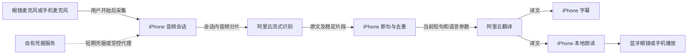

# 基于 OpenVision 的 LensMate 二次开发方案

日期：2026-10-24。依据：[三仓库静态安全审计](security-audit-2026-10-24.md)。状态：设计与任务拆分完成，已建立并改名 [LensMate iOS 开发副本](../ios/README.md)。当前 Xcode 27.1 构建和初版 iPhone 安装已完成；中英泰文字翻译与本地朗读开发及非 UI 验证完成，新功能真实接口与用户 UI 验收待完成。执行清单与实测记录集中在 [todo/](../todo/README.md)。

最新决定：用户已接受审计结论，**保留 OpenVision 现有代码功能，在其上增加新能力**，取消此前大规模功能裁剪方案。Meta SDK 及官方采集可以保留。当前是无屏声音版眼镜，未来可能购买带屏版。新增项见[另外两个项目的功能补充比较](reference-feature-comparison.md)。

## 1. 选型与第一版范围

**以 OpenVision 的固定提交为完整功能基础，新增独立翻译模式。** 保留多模型、实时语音、视觉问答、搜索、工具、文档、记忆、历史、录制、本地模型及已有配置。保留 MIT 声明及来源记录；OpenGlasses 用作功能与工程设计参考，直接复制时须遵守其 BSL 条件；Meta 官方样例用于核对设备接入 API。

第一批已实现中文、英文、泰语六方向的文字输入、原文/译文、iPhone 系统朗读、停止与重播。完整语音版本再增加说话方、持续收音和眼镜/手机输出选择。翻译模式使用独立管线，原来的助手功能继续保留，避免一句翻译被解释成搜索或工具执行命令。

目标是可以验收的低延迟逐段翻译；延迟、准确率和成本都由真实样本测量，不承诺零延迟或用模型宣传速度代替端到端体验。

## 2. 与 Meta AI 的关系

Meta AI 保留，用于官方配对、账号、设备管理等。LensMate 是另一款 iPhone App，控制自己的录音、API 请求和朗读，不能替换眼镜固件里的 Meta AI，也不能预设能接管“Hey Meta”。

首阶段复用 OpenVision 的音频处理和适用设备接入代码，**允许保留 Meta DAT SDK 及官方采集**。将 `GlassesManager` 和 SDK 调用封装为 `MetaDeviceAdapter`，音频采集与播放仍由 iPhone 音频会话管理。翻译不需要的相机持续分析和图片上传不启用。

这是一项待真机验证的工程路线：眼镜是否能提供所需麦克风、手机收音加眼镜播放是否能稳定组合、后台与中断行为，都受 iOS 和眼镜型号影响。纯蓝牙模式可作为技术简化或兼容方案，但不再因为用户已接受的 Meta 采集而强制切换路线。保留 SDK 也不表示可以省略兼容性和数据流验证。

两个 App 可以保留在同一手机，但**不承诺同时占用麦克风或双助手无缝运行**。检测到电话或其他音频中断后，LensMate 暂停当前会话、撤销旧请求和朗读；首版由用户明确恢复。开启眼镜原生助手时，Meta 自己的服务仍按它的设置运行，LensMate 无法替它关闭采集。

## 3. 工作原理与允许的数据范围

原有 [HTML 工作原理图](translation-flow.html) 继续解释新增翻译模式。下述流程与数据规则只适用于翻译模式，不代表移除原有助手功能。当前字幕显示在 iPhone；为未来带屏眼镜预留额外输出接口。



| 数据 | 默认处理 | 允许到达的位置 |
|---|---|---|
| 录音分片 | 仅内存队列；停止后结束采集并释放 | 所选地域的阿里云 ASR |
| 原文短句 | 去重、标记句序号；不携带通用助手历史 | 所选地域的阿里云 MT |
| 翻译上下文 | 初版可为零；确有准确率需要时才加入有限的相邻短句 | 同一个 MT 接口，并在设置中说明 |
| 译文 | 屏幕显示、本机语音合成 | 本机；生成的音频通过系统路由播放 |
| API 凭据 | 个人版 Keychain；分发版长期 Key 留在服务端 | 对应认证/模型服务，不写 URL 日志 |
| 日志 | 耗时、阶段、错误类别、字节数；不含正文 | 默认本机，不自动上传 |
| 会话记录 | 默认不持久化，用户主动保存 | 本机受保护存储；导出由用户操作 |
| 图片、日历、位置、文档 | 新增翻译模式不主动读取；原有助手功能保留 | 助手模式按所用功能、权限和已配置服务处理 |
| Meta SDK 设备交互 / 诊断 | 用户接受官方 SDK 行为；与应用自有业务请求分开归因 | Meta 官方服务，具体字段仍受 SDK 实现影响 |

这里的“允许到达”是我们实现时的规则，还不是上游 App 的现状。阿里云服务端的数据处理以对应服务及账号设置为准；本地朗读也要验证已安装的三语音色，首次下载系统音色可能产生系统联网。

## 4. 保留功能与新增改动

| 上游部分 | 处理 | 原因 |
|---|---|---|
| `AudioSessionManager` / `AudioCaptureService` | 保留；补模式切换与中断恢复 | 助手和翻译协调使用麦克风，避免两个音频引擎互相争用 |
| SwiftUI 会话界面 | 保留原界面，新增翻译入口 | 既有助手继续可用 |
| 系统 TTS 与其他语音引擎 | 保留；翻译优先复用系统朗读 | 原语音选择不删除；验证中英泰音色 |
| `GlassesManager` / MWDAT | 保留并逐步封装设备适配层 | 当前无屏设备正常接入，未来添加显示适配 |
| `SettingsSecrets` / `SettingsManager` | 保留设置与凭据功能 | 密钥失败处理可以作为独立小修复，不以此删除功能 |
| `VoiceCommandService` | 保留助手监听；翻译时切换音频消费者 | 新增三语翻译不依赖原有固定英文监听链 |
| `CloudChat` / OpenClaw / Hermes / OAuth / 多模型 Live | 全部保留 | 通用助手继续按既有配置工作；新增通义适配独立验证 |
| WebSearch / 文档 / 原生工具 / Memories | 全部保留 | 翻译不自动调用这些功能，助手仍可调用 |
| Influx Telemetry | 保留原有可选功能与配置 | 尊重用户选择；不添加新的作者收集端点 |
| MLX / Kokoro / 模型下载 | 保留 | 原有本地模型和语音能力仍有用 |
| 会话历史 / POV 录制 | 保留 | 翻译历史单独设置，后续可增加上一句重播和回顾 |

先跑通原版基线，再增量修改。对 `VoiceAgentViewModel` 等多职责文件只提取新模式需要的公共能力，保持原有行为可回归；不以重构为由整体重写或删除既有功能。日志脱敏、密钥失败处理等审计改进作为独立小补丁安排，不再以大规模裁剪作为开始开发的条件。

## 5. 新模块与关键规则

独立副本已在 `ios/LensMate/` 建立并保留上游布局。后续新增翻译能力可组织为以下模块；以下为完整语音版本的参考布局；本批文字链路已落在 `Services/Translation/` 与 `Views/Translation/`，见[使用说明](text-translation.md)：

```text
LensMate/
  Audio/                 输入、路由、中断、采样格式
  TranslationSession/    开始/停止、句序、取消、短句去重
  Providers/AliyunASR/   音频流与识别事件适配
  Providers/AliyunMT/    文字翻译接口适配
  SpeechOutput/          本地音色、朗读队列与停止
  Security/              Keychain、网络目的地策略、脱敏日志
  UI/                    翻译页、语言与设备选择、设置
  DeviceAdapters/        未来的 DAT 接入，可独立启用
```

`TranslationSession` 管理翻译模式自己的会话，模式协调器负责它与现有助手交接麦克风。每次开始分配新 session ID；每句话有递增 segment ID。partial 识别只更新屏幕，达到稳定条件才提交翻译；同一短句不重复计费或朗读。中文与泰语不能用“空格数量”作为唯一断句条件，应结合 ASR 稳定事件、标点、静音时长和最大等待时间。字幕输出先实现 `PhoneCaptionOutput`，未来带屏设备接 `DisplayCaptionOutput`。

朗读按句序排队；用户停止、切换语言、换说话方或遇到音频中断时，取消在途请求，丢弃旧 session 的结果，清空尚未播放内容。网络失败提示重试，不偷偷换模型或搜索服务。

新增阿里云翻译客户端固定所选地域的 HTTPS/WSS 端点，Key 与地域保持一致，并检查重定向及认证转发。原有 OpenAI 兼容服务、Hermes、OpenClaw 和遥测的自定义地址功能保留，不用一个全局白名单把它们禁掉。未来按各 provider 逐步完善网络检查。

API 选型沿用[阿里云方案](aliyun-translation-plan.md)：先验证流式 ASR、Qwen-MT 与本地朗读。先不把 API Key 填入仓库；个人试用版从设置写入 Keychain，并设置低额度预算。分发版先核对临时凭据是否支持所选 ASR/MT 接口；支持则直连，不支持则由自有后端代理该接口，并说明后端也会经手相应数据，关闭请求正文日志。

## 6. 实施顺序与完成标准

| 阶段 | 具体任务 | 完成标准 |
|---|---|---|
| A：可追溯工作副本（已完成） | 已从固定 OpenVision 提交建立 `ios/` 并改名 LensMate；保留 MIT 与上游信息 | 来源可追溯，原始三个快照仍干净；Vendor 与 LICENSE 内容不变 |
| B：完整基线（进行中） | 构建运行 LensMate；记录原有模型、视觉、工具、历史、录制的验收状态；确认当前无屏眼镜路由 | Xcode 27.1 构建与初版 iPhone 安装已完成；原功能、眼镜和云端服务仍按设备/凭据分项验收 |
| C：手机闭环 | 新增阿里云 ASR/MT 适配；三语字幕、断句、系统朗读；生命周期与取消 | 在 iPhone 上完成六个方向，停止后无旧上传/旧朗读；失败无跨服务回退 |
| D：模式与眼镜验收 | 助手/翻译切换、上一句重播；眼镜输入/输出、手机字幕、锁屏、电话、蓝牙断开、Meta AI 中断 | 原功能可回归；音频不争用；明确可靠路由；不可用时不伪装已连通 |
| E：隐私与成本验收 | 流量、文件、日志、Keychain 故障、费用核查 | 满足审计报告动态验证清单；记录实际每分钟费用及延迟分位数 |
| F：增量补充 | Siri/快捷指令、通义实时语音、音频回顾；之后再考虑离线链和带屏字幕 | 每项独立集成并验证；有屏功能等购买相应硬件后验收 |

B 阶段的完整基线需要 iPhone、眼镜和开发签名；各云端功能按实际可用凭据分项验证。C–E 另需要对应阿里云接口与专用低额度凭据。无设备时可后续接入官方 MockDeviceKit 补充开发检查，但不算真机通过。当前已完成 iOS 构建、初版真机启动及文字翻译批次的 171 项非 UI 测试；新翻译功能的真实 API、UI 和听感仍待用户验收，详见 [调试记录](../todo/debug-status.md)。

## 7. 需要做的有效验证

先写少量针对实际风险的验证：Keychain 写入失败不落明文、请求对象不混入历史/文档/图片、重定向不带出认证、停止后旧回调不能播放、partial 事件不重复提交。它们验证边界行为，不只是复述实现。

三语采用同一组生活场景：点餐、问路、数字价格、日期时间、人名与否定句。每个方向至少 20 段，另覆盖噪声、长停顿、反复改口和中英泰混说。人工记录漏译、错译、重复朗读和断句情况；脚本测试不能代替语义质量评估。

性能按“话说完 → 稳定原文 → 第一段译文 → 开始播放”分别记录，并报告整体 p50/p95；可以先把话说完后约 2 秒开始播放作为优化目标，不作为保证。网络和泰语音色不可用要显示明确状态。账单按实际上传音频时长与翻译 Token 核对，不用免费额度掩盖正常成本。

## 8. 第一版完成后如何使用

1. 在 Meta AI 完成眼镜官方配对，确认 iPhone 能把普通音频播放到眼镜。
2. 安装签名后的 LensMate，设置阿里云地域与个人凭据；确认 Keychain 保存成功。正式分发版则登录自己的凭据服务。
3. 打开新增的翻译入口，检查中英泰系统音色，选择源语言与目标语言，以及当前实际可用的收音/播放设备。原助手入口仍可使用。
4. 点击开始。例如对方说泰语，目标选中文，中文译音经 iPhone 生成后从眼镜播放。
5. 需要自己回答时，切换为中文 → 泰语，选择手机扬声器或展示译文给对方；不假设对方能清楚听到眼镜声音。
6. 点击停止，确认翻译收音结束；按需要返回助手。翻译历史默认不保存，主动保存才进入历史；既有助手历史行为保留。

以上为完整语音版本的目标流程。当前已交付可构建的 LensMate App 和第一批文字翻译代码，操作步骤及验收边界见[文字翻译说明](text-translation.md)；后续已开发[轮流对话翻译](conversation-translation.md)：按句 ASR、可调停顿和眼镜/手机切换代码已完成，真实设备待验收；持续上传的流式 ASR 尚未实现。
